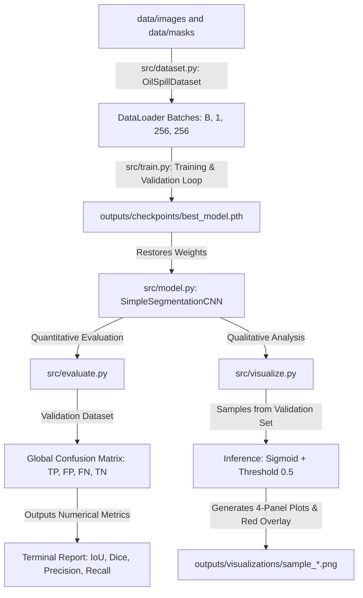

# Program Execution and Data Flow

This document details the actual execution flow across all implemented modules and tracks tensor shapes through each function.

---

## 1. Complete End-to-End Execution Pipeline (Stages 1 through 5)

---

## 2. Module Interactions & Tensor Shapes

### Step 1: Data Ingestion & Augmentation (`src/dataset.py`)
- `OilSpillDataset(images_dir, masks_dir, is_train, augment)`
- Loads 1-channel SAR image $\rightarrow$ `[1, 256, 256]`, `float32`, range $[0.0, 1.0]$.
- Loads mask $\rightarrow$ `[1, 256, 256]`, `float32`, binary values $\{0.0, 1.0\}$.
- Geometric Augmentation (Training only): Applies synchronized horizontal flips, vertical flips, and 90-degree rotations identically to image and mask. Validation data is never augmented.
- `get_dataloaders`: Yields minibatches `[16, 1, 256, 256]`.

### Step 2: Model Architecture (`src/model.py`)
- `SimpleSegmentationCNN(in_channels=1, out_channels=1)`
- Input: `[B, 1, 256, 256]`
- Forward pass: 3 Encoder stages ($256 \rightarrow 128 \rightarrow 64 \rightarrow 32$), Bottleneck ($32 \times 32$), 3 Decoder stages with skip connections ($32 \rightarrow 64 \rightarrow 128 \rightarrow 256$), and $1 \times 1$ conv head.
- Output: Raw logits `[B, 1, 256, 256]`.

### Step 3: Training & Validation (`src/train.py`)
- Training loop: `model.train()` $\rightarrow$ `optimizer.zero_grad()` $\rightarrow$ `logits = model(X)` $\rightarrow$ `loss = criterion(logits, Y)` $\rightarrow$ `loss.backward()` $\rightarrow$ `optimizer.step()`.
- Optimizer: Adam with configurable learning rate (`0.001` or `0.0003`) and optional weight decay (`1e-4`).
- Live terminal feedback: Prints batch progress every 10 batches with running loss and elapsed time.
- Validation loop: `model.eval()`, `with torch.no_grad():` $\rightarrow$ evaluates `val_loss`, `val_dice`, and `val_iou`.
- Early stopping: Halts training if validation loss fails to improve for `patience` consecutive epochs.
- Checkpointing: Saves lowest validation loss model state to `outputs/checkpoints/best_model.pth`.

### Step 4: Quantitative Evaluation (`src/evaluate.py`)
- Restores `best_model.pth` in `model.eval()` mode.
- Computes `probs = torch.sigmoid(logits)` and `preds = (probs >= 0.5).float()`.
- Globally accumulates $\text{TP}, \text{FP}, \text{FN}, \text{TN}$ across all 1,615 validation samples ($105.8\text{M}$ pixels).
- Outputs Precision, Recall, IoU, and Dice score.

### Step 5: Qualitative Visualization (`src/visualize.py`)
- For each selected validation sample:
  1. Input image tensor `[1, 1, 256, 256]` $\rightarrow$ forward pass $\rightarrow$ `pred_np` $\{0, 1\}$.
  2. Calculates individual sample IoU and Dice score.
  3. Constructs a 3-channel RGB overlay highlighting predicted oil spill pixels in red (`[235, 50, 50]`).
  4. Plots a 4-panel comparison:
     - Panel 1: Input SAR Image (Grayscale).
     - Panel 2: Ground Truth Mask (White = Oil).
     - Panel 3: Predicted Mask (with sample IoU and Dice in title).
     - Panel 4: Red Prediction Overlay.
  5. Saves output figure to `outputs/visualizations/sample_{id}_{name}.png`.

---

## 3. Project Pipeline Completion Status
- `src/dataset.py` $\rightarrow$ **[COMPLETED]**
- `src/model.py` $\rightarrow$ **[COMPLETED]**
- `src/train.py` $\rightarrow$ **[COMPLETED]**
- `src/evaluate.py` $\rightarrow$ **[COMPLETED]**
- `src/visualize.py` $\rightarrow$ **[COMPLETED]**
